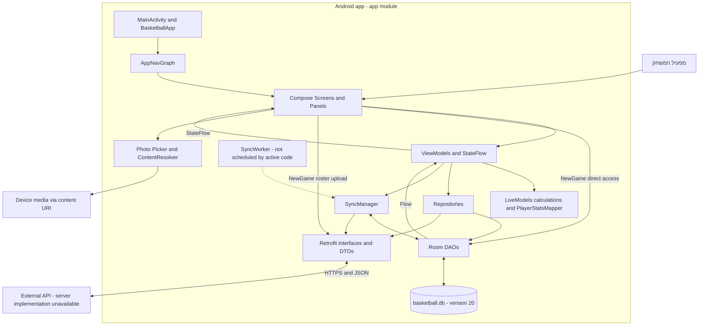
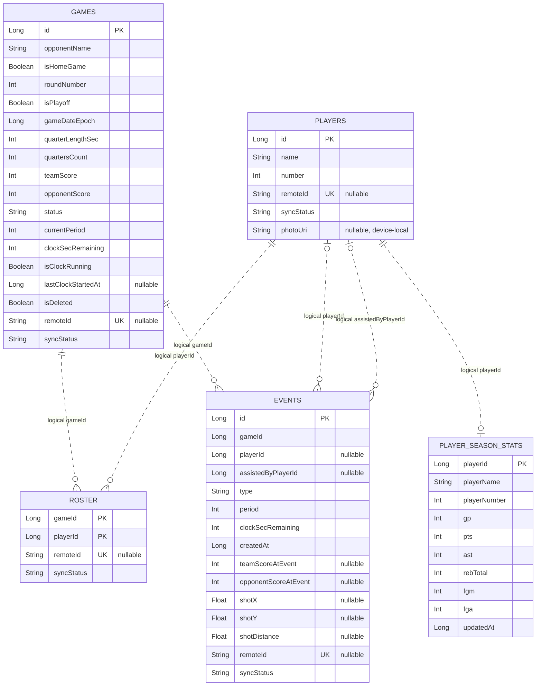
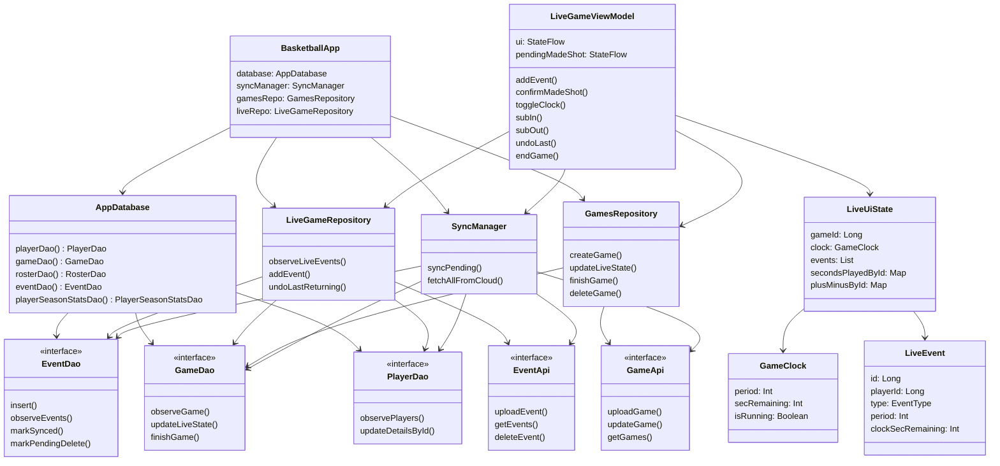
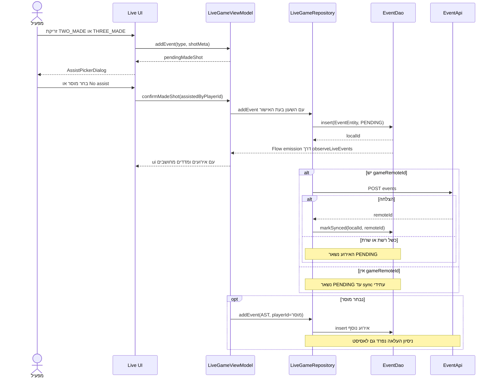
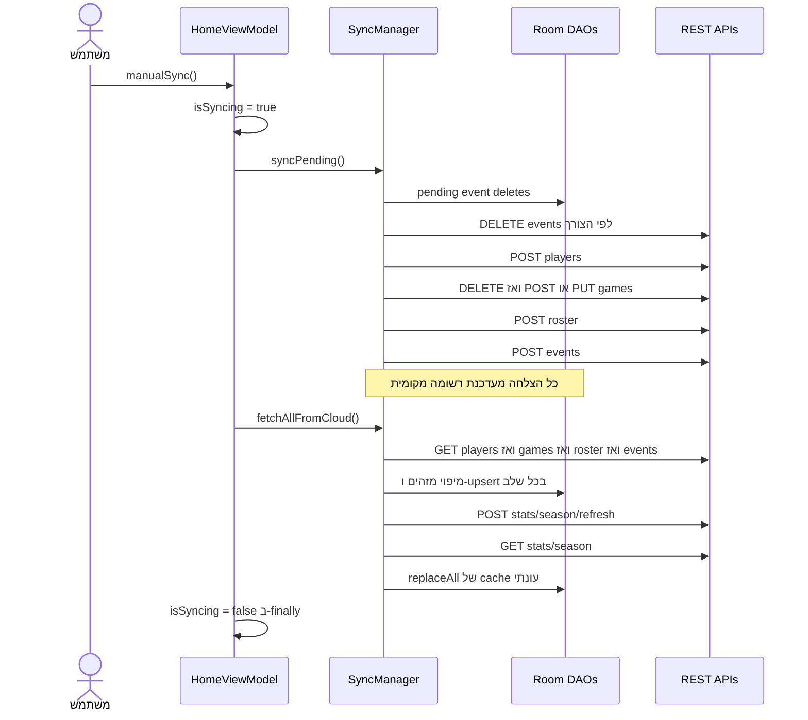
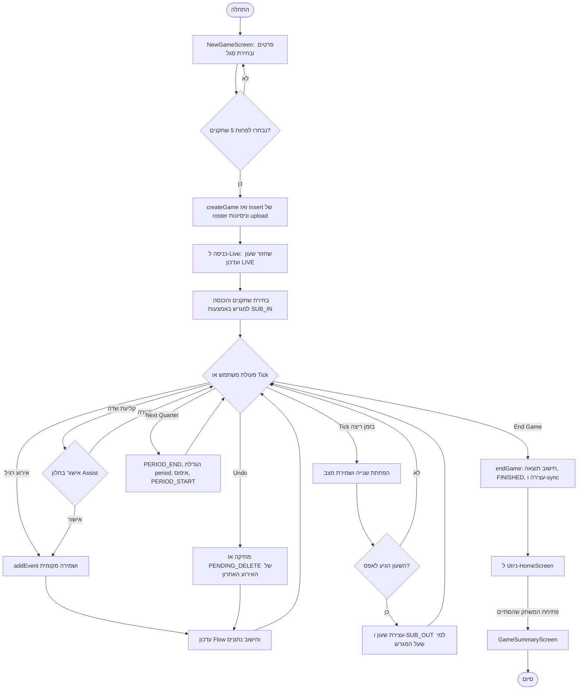

# Basketball Tracker — הקשר לתיכון מערכת מפורט

מסמך מקור להכנת **Detailed System Design** אקדמי בעברית, המבוסס על קוד המקור המקומי.

**תאריך הסקירה:** 26 באוקטובר 2026. **Git HEAD בזמן הסקירה:** `d8d7699`. הסקירה כוללת את ה־Working Tree, לרבות שינויים וקבצים שטרם נכללו ב־commit; אין לייחס את כל המתואר ל־commit זה בלבד.

## גבולות הסקירה ורמת הוודאות

- **ממומש בקוד:** נמצאו הגדרה ומסלול שימוש פעיל. אין בכך אישור שהמסלול עבר בדיקת קצה־לקצה במכשיר.
- **מוגדר אך לא מחובר / מושבת:** קיימת מחלקה, פונקציה, תלות או קבוע, אך לא נמצא מסלול הפעלה פעיל, או שהקוד נמצא בהערה.
- **לא ניתן לאמת:** מידע על השרת, הפריסה, מדיניות האבטחה או התנהגות בזמן ריצה שאינו נובע מקוד הלקוח.
- **ניתוח הנדסי:** הסקת שיקולים ופשרות מתוך המימוש; אין להציגה ככוונה מתועדת של מחבר המערכת.
- **הצעה להמשך:** אפשרות לשיפור בלבד, ולא דרישה מאושרת או יכולת קיימת.

נבדקו קובצי Gradle, Manifest, קוד `app/src/main`, בדיקות ב־`app/src/test` וב־`app/src/androidTest`, ונתיבי הניווט. `APP_FEATURES.md` הוא תיעוד משני של snapshot קודם; במקרה של הבדל, הקוד הנוכחי הוא המקור למסמך זה. לא נמצאו בפרויקט קוד שרת, סכמת DB של השרת או OpenAPI. לא בוצעו פניות לשרת, הרצת האפליקציה, Build או בדיקות בזמן הכנת המסמך. לא בוצע שינוי בקוד הפרויקט.

**מוסכמת נתיבים:** להלן `K/` מציין את `app/src/main/java/com/example/basketballtracker/`. שמות פונקציות הם שמות המימוש, גם כאשר שם הקובץ שונה משם המחלקה. הפניות מפורטות וקישורים מופיעים לאורך המסמך ובנספח.

## 1. System Architecture

### 1.1 מבט מערכתי

המערכת היא אפליקציית Android לתיעוד ידני של משחקי כדורסל, ניהול שחקנים, חישוב נתוני משחק והצגת נתונים היסטוריים ועונתיים. `settings.gradle.kts` מגדיר מודול Gradle יחיד: `:app`. החלוקה ל־features היא חלוקת packages בתוך אותו מודול, ולא Microservices או מודולים נפרדים לבנייה.

הארכיטקטורה בפועל משלבת UI הצהרתי ב־Jetpack Compose, מחלקות ViewModel, מחלקות Repository, שכבת Room מקומית ו־Retrofit לתקשורת עם API חיצוני. תיעוד משחק נשמר תחילה מקומית ולאחריו מתבצע ניסיון העלאה. הנתונים במסכי המשחק נצפים בעיקר מתוך Room. נתוני העונה, לעומת זאת, מיובאים מהשרת ונשמרים מקומית כ־cache.

קיימת קבוצה נעקבת אחת ברמת הממשק, עם הכיתוב `Afeka` במסכים. היריבה מיוצגת בעיקר בשם משחק ובאירועי `OPP_*`; אין ישויות `Team`, `OpponentPlayer`, `User`, `League` או `Season` בסכמת Room הנוכחית.

### 1.2 רכיבים וטכנולוגיות

| רכיב | מימוש שנמצא | תפקיד וגבול האימות |
| --- | --- | --- |
| Android entry point | `MainActivity : ComponentActivity` | יוצר Compose content, ניווט ו־Scaffold; מסתיר System Bars במסך Live |
| Application container | `BasketballApp : Application` | בונה `database`, `syncManager`, `gamesRepo`, `liveRepo`, `statsRepo` באמצעות `by lazy` |
| UI | Kotlin, Jetpack Compose, Material 3, Compose Canvas | מסכים, Panels, Dialogs, Shot Chart וגרפים |
| ניווט | Navigation Compose `2.9.6` | `AppNavGraph`, `Routes`, `BottomNavBar` |
| State ופעולות אסינכרוניות | ViewModel, Coroutines, `Flow`, `StateFlow` | `combine`, `flatMapLatest`, `stateIn`, `viewModelScope` |
| Persistence | Room `2.8.4`, SQLite, KSP | `AppDatabase`, חמישה DAOs וחמש ישויות |
| API client | Retrofit `3.0.0`, Gson converter `3.0.0` | חמש קבוצות interfaces; serialization של DTOs |
| Synchronization | `SyncManager` | העלאת PENDING, הורדה ומיפוי Remote IDs ל־Local IDs |
| Background worker | WorkManager `2.11.2`, `SyncWorker` | Worker קיים; scheduling מחזורי אינו פעיל בקוד |
| תמונות שחקנים | Android Photo Picker, `ContentResolver`, `BitmapFactory`, `ExifInterface` | URI מקומי, הרשאת קריאה מתמשכת, טעינה מוקטנת ותיקון orientation |
| בדיקות | JUnit `4.13.2`, AndroidJUnitRunner, Compose UI tests | קובצי Unit ו־instrumentation קיימים; לא הורצו בסקירה |
| Firebase | Firebase BoM `34.12.0`, תלות Analytics ו־Google Services plugin | אינטגרציה ברמת תלות; לא נמצאו קריאות Analytics עסקיות מפורשות בקוד Kotlin |

תצורת הבנייה מצהירה על Kotlin `2.2.10`, Android Gradle Plugin `9.0.1`, Java/JVM target `11`, `minSdk=26`, `compileSdk=36`, `targetSdk=36`. Compose BoM הוא `2024.09.00`, אך מספר ספריות Compose מוגדרות גם בגרסאות מפורשות; אין להסיק שכל חבילת Compose רצה בגרסת ה־BoM. אלו **גרסאות מוצהרות בקבצים**, לא דוח dependency resolution או אישור תאימות שנבדק בבנייה.

מקורות: [app/build.gradle.kts](app/build.gradle.kts), [Version Catalog](gradle/libs.versions.toml), [settings.gradle.kts](settings.gradle.kts), [Manifest](app/src/main/AndroidManifest.xml).

### 1.3 תקשורת וזרימת מידע

1. פעולת משתמש ב־Composable מועברת לרוב באמצעות callback ל־ViewModel.
2. ViewModel מפעיל Repository או, במסלולים מסוימים, ניגש ל־DB דרך רכיב שהועבר אליו.
3. Repository מבצע DAO write, לעיתים ולאחריו REST upload באותה coroutine. אם ההעלאה נכשלת, הרשומה נשארת `PENDING`.
4. Room מפיק `Flow`; ViewModel ממפה אותו ל־UI State; Compose מציג את המצב החדש.
5. `SyncManager` מבצע סדרת קריאות HTTP רגילות. אין בקוד WebSocket, Server-Sent Events או Push לעדכוני משחק.
6. `HomeViewModel.manualSync()` מפעיל Upload ואז Download. `LiveGameViewModel` מפעיל Upload בתחילת Live, ב־Undo, בסיום משחק ובקצב מוגבל מתוך שמירת השעון.

`RetrofitClient.BASE_URL` הוא `https://basketball-tracker-api.onrender.com`. זוהי כתובת המוגדרת בקוד; זמינות השירות, טכנולוגיית השרת ותצורת hosting בפועל לא אומתו. כל interface נבנה באמצעות Retrofit instance משלו עם Gson; לא מוגדרים בקובץ client מותאם, Interceptor או Authorization header.

### 1.4 תרשים ארכיטקטורה



החצים הישירים מ־UI לנתונים משקפים את `NewGameScreen.startGame()` ולא ארכיטקטורה רצויה תיאורטית. החץ המקווקו מ־Worker מציין מימוש שאין לו תזמון פעיל שנמצא בפרויקט.

## 2. Modular Decomposition

### 2.1 מודולים לוגיים, אחריות ותלויות

| Package / קבצים תחת K/ | רכיבים ואחריות | ממשק עיקרי ותלויות |
| --- | --- | --- |
| `app/navigation/` | `Routes`, `AppNavGraph`, `BottomNavBar`; routing ובניית dependencies למסכים | gameId/playerId בנתיב; תלוי בכל features וב־AppDatabase |
| `core/data/BasketballApp.kt` | Composition Root מעשי | מספק instances ב־lazy ל־Activity ול־Worker |
| `core/data/db/` | `AppDatabase`, migrations, `SyncManager`, `SyncWorker` | Room, חמשת DAOs וחמשת API interfaces |
| `core/data/db/entities/` | מודל Persistence | `PlayerEntity`, `GameEntity`, `RosterEntity`, `EventEntity`, `PlayerSeasonStatsEntity` |
| `core/data/db/dao/` | SQL, שמירה, observation ו־upsert | פונקציות `suspend` ו־`Flow<List<...>>`; ראו סעיף 3 |
| `core/data/remote/` | `RetrofitClient`, DTOs, API interfaces | HTTP/JSON; הפרדה בין DTO upload ובין DTO download |
| `core/data/mapper/` | התאמות Entity ↔ DTO / Domain | `GameEntity.toUploadDto`, `PlayerEntity.toUploadDto`, `PlayerSeasonStatsEntity.toDomain`; `EventMapper.kt` מכיל רק package, מיפוי אירוע נעשה במקום אחר |
| `features/games/data/` | `GamesRepository` | יצירה, עדכון מצב ושעון, סיום ומחיקה; תלוי `GameDao`, `GameApi` |
| `features/newgame/ui/` | `NewGameScreen` | State מקומי ליצירת משחק וסגל; תלוי בשני repositories, שלושה DAOs וב־`rosterApi` ישיר |
| `features/livegame/domain/LiveModels.kt` | מודלי אירוע, שעון ו־Box Score; חישובי דקות, ניקוד, הרכב ו־Plus/Minus | פונקציות על רשימות אירועים; חלקן מקבלות גם `EventEntity`, ולכן השכבה אינה עצמאית לחלוטין מ־Persistence |
| `features/livegame/data/` | `LiveGameRepository` | שמירת אירוע, ניסיון upload, observation ו־Undo; תלוי בשלושה DAOs וב־EventApi |
| `features/livegame/ui/` | `LiveGameViewModel`, `LiveGameTabletScreen`, panels/components | State של המשחק, timer, assist selection, callbacks; תלוי domain, repositories ו־SyncManager |
| `features/home/ui/` | `HomeViewModel`, `HomeScreen` | משחק אחרון ואירועיו, סנכרון ידני |
| `features/history/` | `GamesHistoryViewModel`, `GamesHistoryScreen` בקובץ `GameHistory.kt` | רשימת משחקים ומחיקה; תלוי GamesRepository ו־LiveGameRepository |
| `features/players/` | `PlayersRepository`, `PlayersViewModel`, `RosterScreen`; `PlayerDetailsRepository`, `PlayerDetailsViewModel`, `PlayerStatsMapper` | CRUD מקומי, upload ביצירה, פרופיל וניתוח לפי משחק; תלוי PlayerDao/GameDao/EventDao |
| `features/players/ui/PlayerPhoto.kt` | `PlayerPhoto`, `loadPlayerPhoto` | טעינת תמונה מקומית; תלוי Android media APIs, ללא upload |
| `features/summary/ui/` | `GameSummaryViewModel`, `GameSummaryScreen`, UI models | שילוב אירועים, משחק וסגל לדוח; ViewModel מקבל גם `AppDatabase` ישירות |
| `features/stats/` | `SeasonStatsRepository` בקובץ `SeasonalStatsRepository.kt`, `SeasonStatsViewModel`, `SeasonStatsScreen` | קריאת cache עונתי, totals/per-game ו־leaders; תלוי PlayerSeasonStatsDao |
| `features/core/ui/components/`, `ui/theme/`, `utils/` | רכיבים חוזרים, צבעים/טיפוגרפיה, formatting וגאומטריית זריקה | callbacks ו־UI data; `formatters.kt` מכיל גם `calculateShotDistance` |
| `features/debug/FixGameMinutes.kt` | `fixQuarterBoundarySubs` | helper לתיקון אירועי חילוף; לא נמצא חיבור לזרימת UI פעילה |

### 2.2 חוזי הממשקים המקומיים

| פונקציה | קלט | פלט / תופעת לוואי |
| --- | --- | --- |
| `GamesRepository.createGame(...)` | יריבה, בית/חוץ, מחזור, תאריך, אורך רבע, playoff details | `Long` local game ID; Insert ולאחריו ניסיון POST |
| `GamesRepository.updateLiveState(...)` | gameId, period, secRemaining, isRunning, lastStartedAt | עדכון `games` וסימון PENDING |
| `GamesRepository.finishGame(...)` | gameId ושני ציונים | FINISHED, עצירת clock וסימון PENDING |
| `LiveGameRepository.observeLiveEvents(gameId)` | Local ID | `Flow<List<LiveEvent>>`; מיפוי מתוך Entity |
| `LiveGameRepository.addEvent(...)` | game/player/assist IDs, EventType, period, clock, score snapshots, `ShotMeta?` | Insert וניסיון POST; אינו מחזיר אירוע ל־UI |
| `LiveGameRepository.undoLastReturning(gameId)` | Local ID | `LiveEvent?`; מחיקה מקומית או PENDING_DELETE |
| `PlayersRepository.updatePlayer(...)` | id, name, number, photoUri | עדכון פרופיל מקומי; שינוי שם/מספר מסמן PENDING |
| `PlayerDetailsRepository.observePlayerDetails(...)` | playerId, selectedPeriod nullable | `Flow<PlayerDetailsUiState>` מחיבור player/games/events |
| `SeasonStatsRepository.seasonStats()` | ללא | `Flow<List<PlayerSeasonStats>>` מה־cache |
| `SyncManager.syncPending()` / `fetchAllFromCloud()` | ללא | סדרת upload/download; שגיאות רבות נרשמות ונבלעות פנימית |

אין שכבת Use Cases נפרדת ואין interfaces ל־repositories עצמם. חלק מה־ViewModels נוצרים ב־`remember { ... }`; רק מסלול Live משתמש במפורש ב־`viewModel(...)` עם `ViewModelProvider.Factory` ו־back stack owner. זהו הבדל ממשי בניהול lifecycle ולא MVVM אחיד בכל המסכים.

## 3. Database Design

### 3.1 בסיס הנתונים המקומי

`AppDatabase` הוא RoomDatabase בשם `basketball.db`, בגרסה **20**, עם `exportSchema=false`. הסכמה להלן נגזרת מ־Entity declarations ו־DAO SQL; היא אינה reverse engineering של קובץ DB מתוך מכשיר. אין schema export תחת `app/schemas` בסקירה.

מיפוי טיפוסים: Kotlin `Long`/`Int` ל־SQLite `INTEGER`, `Boolean` ל־INTEGER, `String` ל־TEXT ו־`Float` ל־REAL. `?` בטבלאות מציין nullable. ערכי ברירת המחדל להלן הם של בנאי Kotlin; הם אינם בהכרח SQL DEFAULT בסכמה של התקנה חדשה. migrations מגדירים בחלק מהמקרים DEFAULT בנפרד.

### 3.2 טבלת players — PlayerEntity

| שדה | Kotlin type | מפתח / משמעות / default |
| --- | --- | --- |
| `id` | Long | PK, autoGenerate, default 0 לפני Insert |
| `name` | String | שם השחקן |
| `number` | Int | מספר חולצה; ללא UNIQUE |
| `remoteId` | String? | UNIQUE index, default null |
| `syncStatus` | String | default `PENDING` |
| `photoUri` | String? | default null; URI לתמונה במכשיר, אינו מסונכרן לשרת |

אין שדה `createdAt` ב־PlayerEntity. `PlayerMapper.toUploadDto()` מייצר `createdAt` בזמן יצירת payload באמצעות `System.currentTimeMillis()`.

### 3.3 טבלת games — GameEntity

| שדה | Kotlin type | מפתח / משמעות / default |
| --- | --- | --- |
| `id` | Long | PK autoGenerate, default 0 |
| `opponentName` | String | שם היריבה |
| `isHomeGame` | Boolean | default false |
| `roundNumber` | Int | מחזור |
| `isPlayoff` | Boolean | default false |
| `playoffStage` | String? | null; ערכים מוכרים: QUARTER_FINAL, SEMI_FINAL, FINAL |
| `playoffGameNumber` | Int? | default null |
| `gameDateEpoch` | Long | תאריך משחק ב־epoch milliseconds במסלול היצירה |
| `createdAt` | Long | מועד יצירה ב־milliseconds |
| `quarterLengthSec` | Int | default 600 |
| `quartersCount` | Int | default 4 |
| `teamScore` | Int | default 0 |
| `opponentScore` | Int | default 0 |
| `remoteId` | String? | UNIQUE index, default null |
| `syncStatus` | String | default PENDING |
| `isDeleted` | Boolean | Soft-delete flag, default false |
| `status` | String | default FINISHED; `GameStatus` מגדיר LIVE ו־FINISHED |
| `currentPeriod` | Int | default 1 |
| `clockSecRemaining` | Int | default 600, בנפרד מ־quarterLengthSec |
| `isClockRunning` | Boolean | default false |
| `lastClockStartedAt` | Long? | default null; snapshot timestamp לשחזור שעון |

`GamesRepository.createGame()` משתמש ב־default FINISHED; הכניסה ל־`LiveGameViewModel` מעדכנת ל־LIVE. לכן אין לתאר את ה־Insert הראשוני כאילו הוא כבר LIVE.

### 3.4 טבלת roster — RosterEntity

| שדה | Kotlin type | מפתח / משמעות / default |
| --- | --- | --- |
| `gameId` | Long | חלק מ־PK מורכב; קישור לוגי ל־games.id |
| `playerId` | Long | חלק מ־PK מורכב; קישור לוגי ל־players.id |
| `remoteId` | String? | UNIQUE index, default null |
| `syncStatus` | String | default PENDING |

זוהי טבלת M:N בין משחקים לשחקנים. אין בה שדה starter או onCourt; אלו נגזרים מאירועי חילופים. אין `id` מקומי נפרד ואין `createdAt` מקומי.

### 3.5 טבלת events — EventEntity

| שדה | Kotlin type | מפתח / משמעות / default |
| --- | --- | --- |
| `id` | Long | PK autoGenerate, default 0 |
| `gameId` | Long | קישור לוגי למשחק |
| `playerId` | Long? | יכול להיות null לאירועי יריבה ומערכת |
| `assistedByPlayerId` | Long? | default null; מוסר בקליעת שדה |
| `type` | String | שם של EventType |
| `period` | Int | מספר תקופה, לרבות מעל 4 |
| `clockSecRemaining` | Int | שניות שנותרו בעת האירוע |
| `createdAt` | Long | זמן יצירה ב־milliseconds; משמש לסדר/Undo |
| `teamScoreAtEvent` | Int? | default null; snapshot לתצוגת Play-by-Play |
| `opponentScoreAtEvent` | Int? | default null |
| `shotX` | Float? | default null; קואורדינטה בציר רוחב 15 |
| `shotY` | Float? | default null; קואורדינטה בציר אורך 14 |
| `shotDistance` | Float? | default null; מרחק מחושב מהסל |
| `remoteId` | String? | UNIQUE index, default null |
| `syncStatus` | String | default PENDING; תומך גם SYNCED ו־PENDING_DELETE |

אין `shotZone` ב־Entity העדכני. השדה הוסר ב־migration 18→19 אף שהוא עדיין מופיע במודל Domain וב־DTO הורדה.

### 3.6 טבלת player_season_stats — PlayerSeasonStatsEntity

| שדות | Kotlin type | משמעות |
| --- | --- | --- |
| `playerId` | Long | PK, אינו autoGenerate; קישור לוגי לשחקן מקומי |
| `playerName` | String | שם משוכפל ל־cache |
| `playerNumber` | Int | מספר משוכפל ל־cache |
| `gp` | Int | Games Played כפי שהתקבל מהשרת |
| `pts`, `ast` | Int לכל שדה | נקודות ואסיסטים |
| `rebTotal`, `rebDef`, `rebOff` | Int לכל שדה | ריבאונדים |
| `stl`, `blk`, `tov`, `pf` | Int לכל שדה | חטיפות, חסימות, איבודים, עבירות |
| `fgm`, `fga` | Int לכל שדה | קליעות וניסיונות מהשדה |
| `threem`, `threea` | Int לכל שדה | קליעות וניסיונות לשלוש |
| `ftm`, `fta` | Int לכל שדה | קליעות וניסיונות עונשין |
| `updatedAt` | Long | default `System.currentTimeMillis()` במכשיר בעת בניית Entity |

כל השדות בטבלה זו non-null. אין seasonId, teamId או syncStatus. קיימת לכל היותר רשומת cache אחת לשחקן מקומי, ולא רשומה לכל עונה. `PlayerSeasonStatsDao.replaceAll()` מבצע `clear()` ולאחריו `insertAll()` ב־Transaction.

### 3.7 קשרים, אינדקסים ו־ERD

**לא הוגדרו Room Foreign Keys באף אחת מחמש הישויות.** הקשרים בתרשים הם קשרים לוגיים שהקוד מניח; אין סימון FK פיזי ואין אכיפת referential integrity או ON DELETE CASCADE ב־Entity declarations. טבלת events אינה מחויבת בסכמה לכך שהשחקן חבר ב־roster של המשחק.

מלבד PKs, הוגדרו UNIQUE indices על `remoteId` ב־players/games/roster/events. אין index ייעודי מוצהר על events.gameId או events.playerId, ואין UNIQUE על שם או מספר שחקן. המשמעות היא ששאילתות אירועים רבות עשויות לדרוש סריקה עם גדילת הנתונים; אין benchmark ביצועים לאימות ההשפעה.



התרשים מקצר חלק מהשדות ב־GAMES וב־PLAYER_SEASON_STATS לצורך קריאות; מילון השדות בסעיפים 3.2–3.6 הוא הרשימה המלאה. הקרדינליות מתארת את המודל הלוגי התקין; ללא FK עשויות להתקיים בפועל רשומות יתומות.

### 3.8 DAOs, עקביות ו־Migrations

- `EventDao.observeEvents(gameId)` מסנן `PENDING_DELETE` וממיין לפי period עולה, clock יורד, createdAt עולה. לעומתו `getEvents`, `getAllEvents`, `observeEventsByPlayer` ו־`observeShotEventsForPlayer` אינם מסננים סטטוס זה ב־SQL. `buildPlayerGameStats()` מסנן אותו שוב בעצמו.
- `GameDao.upsertFromCloud()` ו־`EventDao.upsertEventsFromCloud()` שומרים Local ID קיים לפי Remote ID ואז מבצעים update; אין בהם guard מפני דריסת PENDING מקומי.
- `PlayerDao.upsertPlayersFromCloud()` כן מדלג על עדכון שחקן מקומי PENDING ומשמר `photoUri` בעדכון שחקן מסונכרן.
- `RosterDao.insert/insertAll` משתמשים ב־REPLACE. `GameDao.observeAllGames()` אינו מסנן soft-deleted; `getAllActiveGames()` כן מסנן, אך `GamesRepository.observeGames()` משתמש בראשון.
- Transactions קיימים ל־upsert batches ול־replaceAll של cache. אין Transaction משותף ליצירת משחק וכל הסגל, ליצירת קליעה ואסיסט יחד, או למחיקה הכוללת את כל הישויות התלויות.
- רשומות roster אינן נמחקות במפורש במסלול מחיקת משחק שנסקר. מחיקה מרחוק שהתגלתה ב־fetchGames מוחקת מקומית רק game. אין להסיק שהנתונים התלויים מנוקים באופן מלא.

`Migrations.kt` מגדיר מסלול 3→20: תוצאה (3→4), score snapshots (4→5), בית/חוץ (5→6), קואורדינטות זריקה (6→7), sync לאירועים (7→8), sync למשחקים (8→9), sync לשחקנים/סגל (9→10), indices ייחודיים (10→11), shotZone (11→12), soft delete (12→13), cache עונתי (13→14), game status (14→15), assist link (15→16), clock persistence (16→17), playoff (17→18), הסרת shotZone (18→19), תמונת שחקן (19→20).

אין migrations מגרסאות 1–2 ואין `fallbackToDestructiveMigration` בבונה. ב־10→11 שם index של roster הוא `index_rosters_remoteId`, בעוד Entity משתמש בשם אוטומטי הנגזר מ־`roster`; התאמת migration מול Room מחייבת בדיקה. 18→19 משתמש ב־`ALTER TABLE events DROP COLUMN shotZone`; תאימות SQLite בכל מכשירי minSdk לא אומתה. אין לטעון שכל מסלולי השדרוג עברו בדיקה.

## 4. API Specification

### 4.1 גבולות החוזה

זהו **Client-observed API contract**: annotations ו־DTOs המוגדרים ב־`K/core/data/remote/`. אלו אינם תיעוד מאומת של routes בשרת. כל הפונקציות הן `suspend`. Upload bodies משתמשים בשמות camelCase; רוב DTOs של download משתמשים ב־snake_case. JSON מומר באמצעות Gson.

בכל endpoint להלן **לא מוגדרים בצד הלקוח Authorization headers, JWT, API Key, Cookie authentication או role checks**. אין מסכי Login או מודל משתמש. אי אפשר להסיק מכך מה השרת אוכף בפועל. הרשאת Android `INTERNET` היא הרשאת פלטפורמה, ואינה הרשאת משתמש במערכת.

לא הוגדרו query parameters, pagination, API version prefix, חוזה שגיאות או HTTP success codes מפורשים. `Unit` בטבלה אומר שהלקוח אינו ממדל Response body; אין בכך קביעה שהשרת מחזיר דווקא 204. Nullability להלן היא זו שב־Kotlin DTOs, ולא validation server-side.

### 4.2 כל ה־Endpoints המוגדרים

| Method ונתיב | פונקציה | פרמטרים / Request | Response שמצופה בלקוח | שימוש בקוד |
| --- | --- | --- | --- | --- |
| `POST /games` | `GameApi.uploadGame` | Body: GameUploadDto | GameUploadResponse `{remoteId: String}` | יצירה ו־sync של משחק ללא remoteId |
| `PUT /games/{remoteId}` | `GameApi.updateGame` | Path String; Body: GameUploadDto | Unit | sync של משחק קיים מרחוק |
| `PATCH /games/score` | `GameApi.updateGameScore` | Body: GameScoreUpdateDto | Unit | עטוף ב־GamesRepository.updateGameResult; לא נמצאה קריאה פעילה לפונקציית repository זו |
| `GET /games` | `GameApi.getGames` | ללא | List<GameRemoteDto> | fetch ו־reconciliation |
| `DELETE /games/{remoteId}` | `GameApi.deleteGameFromCloud` | Path String; ללא Body | Unit | מחיקה ישירה וניסיון חוזר ב־sync |
| `POST /players` | `PlayerApi.uploadPlayer` | Body: PlayerUploadDto | PlayerUploadResponse `{remoteId: String}` | יצירה וכל player PENDING, גם אחרי עריכה |
| `GET /players` | `PlayerApi.getPlayers` | ללא | List<PlayerRemoteDto> | fetch שחקנים |
| `POST /roster` | `RosterApi.uploadRoster` | Body: RosterUploadDto | RosterUploadResponse `{remoteId: String}` | NewGame ו־sync |
| `GET /roster` | `RosterApi.getRoster` | ללא | List<RosterRemoteDto> | fetch סגל |
| `POST /events` | `EventApi.uploadEvent` | Body: EventUploadDto | EventUploadResponse `{remoteId: String}` | תיעוד אירוע ו־sync |
| `GET /events` | `EventApi.getEvents` | ללא | List<EventRemoteDto> | fetch כל האירועים |
| `DELETE /events/{remoteId}` | `EventApi.deleteEvent` | Path String; ללא Body | Unit | מחיקת אירועים PENDING_DELETE |
| `POST /stats/season/refresh` | `StatsApi.refreshSeasonStats` | ללא Body | Unit | קודם לכל fetch עונתי במסלול sync |
| `GET /stats/season` | `StatsApi.getSeasonStats` | ללא | List<PlayerSeasonStatsRemoteDto> | החלפת ה־cache העונתי |

אין endpoint מוגדר למחיקת שחקן, עדכון שחקן ב־PUT/PATCH, מחיקת roster או העלאת תמונה. האם POST players מבצע upsert או יצירה בלבד אינו ניתן לאימות ללא השרת. `DeleteGameDto` קיים בקוד אך אינו Body של פעולת DELETE המוגדרת.

### 4.3 מבני Request מלאים

הרישום הבא הוא Schema תיאורי בסימון Kotlin, ולא קוד חדש או דוגמת JSON literal. `?` מציין nullable. השמות הם שמות שדות ה־JSON בהעלאה.

```text
GameUploadDto {
  localId: Long?, opponentName: String?, isHomeGame: Boolean,
  roundNumber: Int, isPlayoff: Boolean, playoffStage: String?,
  playoffGameNumber: Int?, gameDateEpoch: Long, createdAt: Long,
  quarterLengthSec: Int, quartersCount: Int, teamScore: Int,
  opponentScore: Int, status: String, currentPeriod: Int,
  clockSecRemaining: Int, isClockRunning: Boolean,
  lastClockStartedAt: Long?
}
GameScoreUpdateDto {
  remoteId: String, teamScore: Int, opponentScore: Int
}
PlayerUploadDto {
  localId: Long?, name: String, number: Int, createdAt: Long
}
RosterUploadDto {
  gameId: Long, playerId: Long, gameRemoteId: String,
  playerRemoteId: String, createdAt: Long
}
EventUploadDto {
  localId: Long?, gameId: Long, playerId: Long?,
  assistedByPlayerId: Long?, gameRemoteId: String,
  playerRemoteId: String?, assistedByPlayerRemoteId: String?,
  type: String, period: Int, clockSecRemaining: Int, createdAt: Long,
  teamScoreAtEvent: Int?, opponentScoreAtEvent: Int?,
  shotX: Float?, shotY: Float?, shotDistance: Float?
}
```

`RosterUploadDto.createdAt` מקבל default של הזמן הנוכחי. Local IDs ו־Remote IDs נשלחים במקביל בחלק מהבקשות. `syncStatus`, `isDeleted` ו־`photoUri` אינם נשלחים במבנים אלה. לא הוגדר `serializeNulls()`; אין להניח ששדה nullable נשלח תמיד כ־JSON null.

דוגמה המחשה בלבד ל־`POST /players` ולתגובה המצופה:

```json
{"localId": 12, "name": "Example Player", "number": 7, "createdAt": 1793000000000}
```

```json
{"remoteId": "example-remote-player-id"}
```

### 4.4 מבני Response מלאים של GET

```text
GameRemoteDto {
  id: String, local_id: Long?, opponent_name: String,
  is_home_game: Boolean, round_number: Int, is_playoff: Boolean,
  playoff_stage: String?, playoff_game_number: Int?,
  game_date_epoch: Long, created_at: Long, quarter_length_sec: Int,
  quarters_count: Int, team_score: Int, opponent_score: Int,
  status: String, current_period: Int, clock_sec_remaining: Int,
  is_clock_running: Boolean, last_clock_started_at: Long?
}
PlayerRemoteDto {
  id: String, local_id: Long?, name: String, number: Int,
  created_at: Long?
}
RosterRemoteDto {
  id: String, local_game_id: Long, local_player_id: Long,
  game_remote_id: String?, player_remote_id: String?, created_at: Long?
}
EventRemoteDto {
  id: String, local_id: Long?, local_game_id: Long?, local_player_id: Long?,
  game_remote_id: String?, player_remote_id: String?, type: String,
  period: Int, clock_sec_remaining: Int, created_at: Long,
  team_score_at_event: Int?, opponent_score_at_event: Int?,
  shot_x: Float?, shot_y: Float?, shot_distance: Float?, shot_zone: String?,
  assisted_by_player_id: Long?, assisted_by_player_remote_id: String?
}
PlayerSeasonStatsRemoteDto {
  player_id: String, player_name: String, player_number: Int,
  gp: Int, pts: Int, ast: Int, reb_total: Int, reb_def: Int, reb_off: Int,
  stl: Int, blk: Int, tov: Int, pf: Int, fgm: Int, fga: Int,
  threem: Int, threea: Int, ftm: Int, fta: Int
}
```

כל GET מחזיר לפי החתימה מערך JSON ישיר, ללא envelope ממודל. `id`/`player_id` המרוחקים הם String, ואילו Local IDs הם Long. הלקוח ממפה לפי Remote ID ולא אמור להניח זהות בין Local IDs במכשירים שונים.

### 4.5 שגיאות, הרשאות וגבולות הסנכרון

- פעולות upload רבות תופסות `Exception`, מדפיסות Log או stack trace ומשאירות PENDING. לא קיים טיפוס Domain משותף לשגיאה או טיפול מפורט לפי 400/401/409/500.
- `SyncWorker.doWork()` מחזיר retry אם חריגה מגיעה אליו; רוב פעולות `SyncManager` תופסות שגיאות פנימית. לכן הצלחת Worker אינה הוכחה שכל הרשומות סונכרנו.
- אין ETag, version field, Idempotency-Key, transaction מרוחק או conflict-resolution protocol בקוד הלקוח. מנגנון מניעת כפילויות בשרת אינו ידוע.
- `fetchEventsFromCloud()` ממפה `game_remote_id` ו־`player_remote_id`, אך מציב `assistedByPlayerId = dto.assisted_by_player_id` ואינו ממפה את `assisted_by_player_remote_id`. זהו פער אפשרי בין מכשירים.
- Manifest מתיר `usesCleartextTraffic=true`, אף שהכתובת המוגדרת היא HTTPS. אין הצפנת DB מפורשת או הרשאות לפי תפקיד בקוד שנבדק. `allowBackup=true`; קובצי backup מכילים תצורת תבנית ולא מדיניות עסקית מפורטת.

## 5. UML Diagrams המשקפים את המימוש

### 5.1 Class Diagram

התרשים מציג את השלד המרכזי ולא כל שדה/Composable. פונקציות חישוב ב־`LiveModels.kt` הן top-level functions ולכן אינן מוצגות כמחלקת Service מומצאת.



`LiveEvent.playerId` nullable בפועל; התרשים מקצר טיפוסים, והחתימות המלאות הן בקוד ובמילון הנתונים. SyncManager תלוי בנוסף ב־RosterDao/PlayerSeasonStatsDao וב־PlayerApi/RosterApi/StatsApi שהושמטו מהתרשים לצמצום עומס.

### 5.2 Sequence — קליעת שדה עם אסיסט



קליעה ואסיסט אינם Transaction אטומי; ה־AST נוסף אחרי שקריאת repository לקליעה מסתיימת, לרבות ניסיון הרשת שלה. ביטול ה־dialog מפעיל `dismissAssistPicker()` ומבטל את הקליעה הממתינה. זמן האירוע נלקח בעת האישור, לא בעת הנגיעה הראשונית במגרש.

### 5.3 Sequence — סנכרון ידני



התרשים מציג את הסדר, לא מבטיח הצלחה בכל שלב. כשל שנתפס בשלב אחד אינו בהכרח עוצר את השלבים הבאים.

### 5.4 Activity — מחזור משחק

Mermaid אינו כולל כאן תחביר UML Activity ייעודי; ה־flowchart הבא מייצג את הפעילויות וההחלטות בקוד.



סיום הרבע האוטומטי אינו מגדיל period ואינו מסיים משחק; מעבר הרבע וסיום המשחק הם פעולות נפרדות. ב־`AppNavGraph` סיום משחק מחזיר ל־HOME, ומשם ניתן לפתוח את סיכום המשחק שהסתיים. החזרה ל־HOME מופעלת לאחר הקריאה ל־`endGame()` בלי להמתין במפורש להשלמת ה־coroutine ששומרת את הסיום.

## 6. Algorithms

### 6.1 מודל אירועים ועיבוד המשחק

מקור: [LiveModels.kt](app/src/main/java/com/example/basketballtracker/features/livegame/domain/LiveModels.kt), [LiveGameViewModel.kt](app/src/main/java/com/example/basketballtracker/features/livegame/ui/LiveGameViewModel.kt), [LiveGameRepository.kt](app/src/main/java/com/example/basketballtracker/features/livegame/data/LiveGameRepository.kt).

`EventType` מכיל:

- קליעות הקבוצה: `FT_MADE`, `FT_MISS`, `TWO_MADE`, `TWO_MISS`, `THREE_MADE`, `THREE_MISS`.
- פעולות שחקן: `REB_OFF`, `REB_DEF`, `AST`, `STL`, `TOV`, `BLK`, `PF`.
- חילופים: `SUB_IN`, `SUB_OUT`.
- יריבה: `OPP_TWO_MADE`, `OPP_THREE_MADE`, `OPP_FT_MADE`, `OPP_TWO_MISS`, `OPP_THREE_MISS`, `OPP_FT_MISS`, `OPP_PF`.
- מערכת: `PERIOD_START`, `PERIOD_END`.

`addEvent()` בוחר playerId לפי סוג הפעולה: אירוע יריבה או `noPlayer` מקבלים null; אחרת override או selectedPlayerId. אירוע שדורש שחקן נדחה אם אין בחירה. `requiresPlayer()` אינו מגדיר SUB_IN/SUB_OUT כפעולות מחייבות שחקן, אך מסלולי `subIn/subOut` מספקים override בפועל.

המרת `EventEntity.toDomain()` משתמשת ב־`EventType.valueOf(type)`. אין fallback עבור סוג אירוע לא מוכר מהשרת, ולכן התאימות לערכי enum היא הנחת חוזה ממשית.

`computeTeamScore` ו־`computeOppScore` סופרים קליעות מוצלחות ומחשבים:

```text
score = 1 * freeThrowsMade + 2 * twoPointMade + 3 * threePointMade
```

`computeBoxByPlayer()` יוצר Map של PlayerBox ומצטבר על האירועים: כל קליעה מוצלחת מגדילה גם attempts, החטאה מגדילה attempts בלבד. נקודות, ריבאונדים, אסיסטים, חטיפות, חסימות, איבודים ועבירות מחושבים מאירועים; `fgm=twom+threem`, `fga=twoa+threea`, `rebTotal=rebOff+rebDef`. אחוזים ב־PlayerBox מעוגלים ל־Int, ו־0 attempts מחזיר 0. מסכי פרופיל משתמשים גם באחוזי Double דרך PlayerGameStats.

ניקוד במסך Live נגזר מהאירועים, ולא מ־score snapshots. snapshot נשמר בחלק מהאירועים לתצוגת Play-by-Play. בעת רצף מהיר של פעולות, חישוב snapshot מתוך `ui.value.events` עלול להקדים את ה־Flow emission של אירוע קודם; אין בקוד Transaction שמבטיח עדכון אטומי של snapshot וניקוד.

### 6.2 חישוב שניות ודקות משחק

הפונקציה המרכזית היא `computeSecondsPlayedByPlayer(events, quarterLengthSec, currentPeriod, currentClockSecRemaining)`.

1. ממירים clock יורד לציר זמן עולה באמצעות `toGameElapsedSec()`:

```text
t(period, remaining, Q) = max(period - 1, 0) * Q + (Q - remaining)
```

2. ממיינים אירועים לפי `(period ASC, clockSecRemaining DESC, createdAt ASC)`.
3. מחזיקים `inTime[playerId]` של כניסה פתוחה ו־`total[playerId]` מצטבר.
4. ב־SUB_IN שומרים זמן כניסה רק אם אין כניסה פתוחה; כניסה כפולה נזנחת.
5. ב־SUB_OUT מסירים את זמן הכניסה ומוסיפים `max(0, tOut - tIn)`. יציאה ללא כניסה נזנחת.
6. אחרי סריקת האירועים, כניסות פתוחות נסגרות לצורך החישוב מול הזמן הנוכחי `nowT`.

דוגמה מחושבת: ברבע של 600 שניות, כניסה ברבע 1 כאשר נותרו 120 שניות נותנת `tIn=480`; יציאה ברבע 2 כאשר נותרו 480 שניות נותנת `tOut=720`. התוצאה היא 240 שניות, כלומר ארבע דקות. זו דוגמת חישוב, לא תוצאת ריצה שבוצעה בסקירה.

הסיבוכיות היא `O(E log E + P)` בזמן ו־`O(E + P)` בזיכרון כולל הרשימה הממוינת, כאשר E מספר האירועים ו־P מספר השחקנים. Map הצבירה לבדו דורש `O(P)`.

פונקציות נוספות: `computeSecondsPlayedForPlayer`, `computeSecondsPlayedForPlayerInPeriod`, ושתי גרסאות `AfterEnd` המקבלות EventEntity. גרסאות InPeriod סורקות רק את הרבע הנבחר ולכן אינן משחזרות לבדן כניסה מרבע קודם. במסלול ההיסטורי העדכני `buildPlayerGameStats()` פותר זאת באמצעות הפרש מצטבר:

```text
secondsForPeriod(p) = max(0, secondsThroughPeriod(p) - secondsThroughPeriod(p - 1))
```

בפרופיל שחקן, חישוב כל המשחק נסגר בסוף `max(game.quartersCount, maxEventPeriod)`. ב־GameSummaryViewModel משתמשים ב־`game.quartersCount` וב־remaining=0. אין להניח שהתוצאות זהות עבור משחק שהסתיים מוקדם או הארכה עם כניסה שלא נסגרה.

`formatMinutes()` מחזיר רק את החלק השלם `seconds / 60`; הוא אינו מציג mm:ss ואינו מעגל למעלה. שעון המשחק עצמו מוצג דרך `formatClock()` בפורמט דקות:שניות.

**פערים קונקרטיים שחשוב לציין בתיכון:** `PlayersPanel` מעביר `quarterLengthSec=10` בחלון הנתונים החי, בעוד יתר המסלולים משתמשים לרוב ב־600 או בערך המשחק. בחלק מאותו חלון נבחר `selectedId` במקום `sheetPlayerId`. בנוסף, `LiveGameTabletScreen` מחשב Box בתוך `remember(s.events)` בלבד, אף שהחישוב מקבל גם clock. לכן אין להצהיר על חישוב דקות אחיד ומעודכן בכל רכיבי UI ללא תיקון/בדיקה.

### 6.3 הרכב ו־Plus/Minus

`computeOnCourtIds()` סורק את האירועים לפי הסדר שהתקבל: SUB_IN מוסיף ל־LinkedHashSet, SUB_OUT מסיר. הוא אינו ממיין פנימית. `PlayersPanel` מאפשר כניסה מהמחליפים רק אם `onCourtPlayers.size < 5`; זו מגבלת UI, לא constraint ב־DB או validation מרכזי ב־Repository.

`computePlusMinusByPlayer()` ממיין לפי `(period, -remaining, createdAt, id)`, מנהל set של onCourt ומוסיף לכל שחקן שנמצא במגרש את הפרש הנקודות של האירוע: `+1/+2/+3` לקבוצה ו־`-1/-2/-3` ליריבה. שחקן שנכנס מקבל תחילה ערך 0. `computePlusMinusForPlayer()` מבצע אותו עיקרון לשחקן בודד.

הסיבוכיות היא `O(E log E + E*K)` בזמן, כאשר K מספר השחקנים הנמצאים במגרש; בזרימת UI תקינה K≤5. חישוב על אירועי רבע בלבד עשוי לאבד מידע על מי שכבר היה במגרש בתחילתו. זיהוי החמישייה בסיכום (`detectStartersByCreatedAt`) מחזיר את הקבוצה הראשונה של חמישה שחקנים שנמצאו יחד לאחר סריקת חילופים לפי createdAt; הוא אינו מבוסס על שדה starter מפורש ואינו מוגבל במפורש לרבע הראשון.

### 6.4 שעון משחק ושחזור

`startClockLoop()` מריץ `delay(1000)` בלולאה ב־viewModelScope. כל עוד isRunning, הוא מפחית שנייה, שומר את המצב דרך `persistClock()` ומפסיק באפס. זהו timer יישומי מבוסס השהיה, לא שעון מונוטוני מדויק או שירות foreground.

`persistClock()` כותב period, remaining, running ו־timestamp נוכחי; GameDao מסמן PENDING. `syncLiveStateThrottled()` מפעיל `syncPending()` לכל היותר לפי סף התחלה של חמש שניות בין הפעלות, אך אינו מונע חפיפה אם סנכרון קודם עדיין רץ.

`restoreLiveGameState()` מחשב, אם השעון נשמר כרץ:

```text
elapsedSeconds = floor((nowMillis - lastClockStartedAt) / 1000)
restoredSeconds = max(0, savedRemaining - elapsedSeconds)
running = savedRunning AND restoredSeconds > 0
```

כאשר שעון הלולאה מגיע לאפס, `endQuarterAuto()` מוסיף SUB_OUT לכל onCourt ב־clock=0. מסלול שחזור שהגיע לאפס אינו קורא לאותה פונקציה. מעבר ידני ל־`nextQuarter()` מוסיף PERIOD_END, מגדיל period, מאפס ל־quarterLengthSec ומוסיף PERIOD_START; אינו יוצר אותה סדרת SUB_OUT אוטומטית.

אין משך הארכה נפרד או סיום אוטומטי אחרי ארבעה רבעים. `adjustPeriod()` מוגבל ל־1..10, אך `nextQuarter()` פשוט מגדיל את הערך. מסלול הניווט מעביר ל־LiveGameViewModel את `quarterLengthDefault=600`, ולא טוען ממנו את אורך הרבע השמור במשחק. לכן יכולת פרמטריזציה קיימת בשכבות הנתונים אך אינה מחוברת בעקביות ל־Live UI.

### 6.5 Shot Chart: קלט, גאומטריה ותצוגה

מקורות: [ActionsPanel.kt](app/src/main/java/com/example/basketballtracker/features/livegame/ui/panels/ActionsPanel.kt), [formatters.kt](app/src/main/java/com/example/basketballtracker/utils/formatters.kt), [PlayerDetailsScreen.kt](app/src/main/java/com/example/basketballtracker/features/players/ui/PlayerDetailsScreen.kt).

`HalfCourtClickable()` משתמש בתמונת Vector drawable בשם `court_15x14_original_parquet` וב־Canvas. קלט מיקום מתקבל **רק מ־`PointerType.Stylus`**. מגע אצבע אינו מתועד כזריקה על המגרש. לחיצה קצרה מתועדת כהחטאה; החזקה של 500ms מתועדת כקליעה, עם Haptic feedback. ניתן לתעד אירועי קליעה גם באמצעות כפתורים, אך ללא ShotMeta לא יהיה מיקום להצגה במפה.

`buildShotMeta()` ממיר פיקסלים למרחב 15×14:

```text
x = tapX / courtWidthPx * 15
y = tapY / courtHeightPx * 14
distance = sqrt((x - 7.5)^2 + (y - 1.575)^2)
```

המרחב משקף מידות חצי מגרש, והמרחק נגזר מאותן יחידות; לא נאסף ממדידה פיזית או מ־tracking אוטומטי. `isThreePointShot(x,y)` פועל בדיוק כך:

```text
if y <= 2.99:
    three = (x <= 0.9) OR (x >= 14.1)
else:
    three = distanceFromHoop >= 6.75
```

לפי התוצאה ולפי משך הלחיצה נוצרים TWO_MADE/TWO_MISS/THREE_MADE/THREE_MISS. `ShotMeta(x,y,distance)` נשמר בשדות האירוע ונשלח ב־DTO. אין clamp מפורש של x/y בטווח בפונקציה זו.

להצגה חוזרת: `pixelX = x/15*canvasWidth`, `pixelY = y/14*canvasHeight`. קליעה מסומנת בעיגול ירוק חלול, החטאה ב־X אדום. הנתונים מסוננים לפי שחקן ותקופה במסכים הרלוונטיים; אירועים ללא קואורדינטות אינם מצוירים. `EventType.isShotEvent()` כולל ארבעה סוגי זריקות שדה של הקבוצה בלבד, ללא עונשין וזריקות יריבה.

סיווג זריקה בודדת הוא `O(1)`; סינון וציור S זריקות הם `O(S)`. אין Heatmap, זיהוי באמצעות Computer Vision או חישוב פעיל של אחוזים לפי ShotZone שנמצא במסלול זה. `ShotZone`, `ZoneStats`, `toShotZoneOrNull` ושדה domain ישנים אינם הוכחה לתכונת zones פעילה. במסך פרטי שחקן יש ל־`ShotChart()` לוגיקת makes/misses, אך פקדי הסינון ב־`ShotChartCard()` נמצאים בהערה והערך נשאר `all`.

### 6.6 Undo ומחיקה

`LiveGameViewModel.undoLast()` משתמש ב־`undoLastReturning()`. `EventDao.getLastEvent()` בוחר את האירוע הפעיל האחרון לפי createdAt, ולא לפי הסדר הגאומטרי של זמן המשחק. אם אין remoteId, האירוע נמחק פיזית; אחרת הוא מסומן PENDING_DELETE ונעלם מה־Flow החי. `syncPendingEventDeletes()` שולח DELETE ומוחק מקומית אחרי הצלחה.

Undo מבטל **אירוע אחד**, לא פעולה עסקית מורכבת. לאחר קליעה עם אסיסט, האירוע האחרון עשוי להיות AST, ולכן Undo ראשון ישאיר את הקליעה ואת assistedByPlayerId שלה. אין Redo או transaction ID שמקבץ את שתי הרשומות. הפונקציה הנוספת `LiveGameRepository.undoLast()` מוחקת פיזית בלבד, אך אינה זו שנקראת מה־ViewModel במסלול הנוכחי.

### 6.7 Synchronization Algorithm

Upload מתבצע בסדר: pending event deletes → players → games, כולל מחיקות → roster → events. הסדר מאפשר להשיג Remote IDs של הורים לפני upload של children. Roster בלי gameRemoteId או playerRemoteId מדולג. Event בלי gameRemoteId מדולג; playerRemoteId יכול להישאר null. בהצלחה נשמר remoteId והמצב הופך ל־SYNCED.

Download מתבצע בסדר players → games → roster → events → refresh/fetch season stats. Roster ואירועים ללא משחק/שחקן נדרש שניתן למפות מדולגים. משחקים מקומיים בעלי remoteId שאינו ברשימת GET games נמחקים פיזית. זו הנחת **snapshot מלא** של GET games; אין pagination בחוזה הלקוח.

זו אסטרטגיית Local-first עם התכנסות בעת סנכרון, אך לא הוכחה ל־Eventually Consistent protocol מלא: אין מנעול גלובלי, גרסאות, conflict resolution אחיד או הגנת PENDING לכל הישות. העלאה ישירה ו־SyncManager עשויים לטפל באותה רשומה במקביל. המימוש אינו מבטיח Exactly-once; Idempotency תלויה בהתנהגות השרת שלא סופקה.

### 6.8 סטטיסטיקות עונתיות והיסטוריות

`PlayerDetailsRepository` מקבץ אירועי שחקן לפי gameId ומחשב `buildPlayerGameStats()` לכל משחק שנמצא בטבלת games. ממוצע שחקן הוא average על רשימת המשחקים שנבנתה מאירועים; רישום בסגל בלי אירוע אינו בהכרח נספר במשחקי הפרופיל.

המסך העונתי קורא totals מן השרת דרך cache. `buildLeaderCategories()`, `top3By()`, `valueByMode()` ו־`formatStat()` ב־`SeasonalStatsScreen.kt` יוצרים מובילים ונתוני TOTAL/PER_GAME; חלוקה במשחקים מגינה על מקרה 0. נתוני קבוצה מחושבים מסכום נתוני השחקנים, ו־GP קבוצתי נלקח מ־`max(gp)` של השחקנים. זהו אומדן מתוך aggregates, לא ספירה של games מקומיים. חישוב ה־aggregates בשרת, הגדרת עונה והכללת LIVE/playoff אינם ניתנים לאימות.

## 7. Design Patterns הקיימים בפועל

| Pattern / סגנון | עדות בקוד | דיוק והסתייגות |
| --- | --- | --- |
| MVVM | LiveGameTabletScreen ← StateFlow ← LiveGameViewModel → repositories; דפוס דומה בפרופיל ובעונה | אינו מוחל באופן מלא: NewGame מנהל גם persistence/network בתוך Composable |
| Repository | GamesRepository, LiveGameRepository, PlayersRepository, PlayerDetailsRepository, SeasonStatsRepository | מרכזים גישה לנתונים בחלק מהמערכת; ללא Repository interfaces נפרדים |
| DAO | EventDao/GameDao וכו', עם Room annotations | הפרדה בין SQL וצרכני נתונים; מופעים ממומשים באמצעות Room generation |
| Observer / Reactive Streams | Room Flow → combine/map/stateIn → collectAsState | UI מתעדכן משינוי DB; אין Event Bus ייעודי |
| DTO + Data Mapping | GameUploadDto, EventRemoteDto, `toUploadDto`, `toDomain` | מפחית תלות בצורת JSON בחלק מהקוד; חלק מהמיפויים עדיין inline ב־SyncManager |
| Manual Dependency Injection | constructors של ViewModels/repositories, BasketballApp, AppNavGraph | ללא Hilt/Koin; בחלק מהקוד קיימת תלות גלובלית ב־RetrofitClient |
| Singleton / Lazy initialization | `object RetrofitClient`, `object Routes`, `by lazy` ב־BasketballApp | AppDatabase.getDatabase עצמו אינו Singleton מובטח: כל קריאה בונה DB; השיתוף הרגיל נשען על lazy ב־Application |
| Factory | anonymous `ViewModelProvider.Factory` במסלול Live | יצירה עם gameId, roster ותלויות באמצעות ViewModelStoreOwner |
| Event-based state reconstruction | computeBoxByPlayer, computeOnCourtIds, minutes ו־Plus/Minus | דומה לרעיון Event Sourcing, אך log ניתן למחיקה ולשינוי, ויש state/totals נוספים; אין Event Sourcing מלא או CQRS מתועד |
| Persistent pending-work flags | PENDING/PENDING_DELETE ו־SyncManager | דומה ל־Outbox מצומצם; אין טבלת outbox או atomic transactional-outbox מלאה |

אין בסיס לייחס לפרויקט Microservices, Clean Architecture מלאה, GoF Command objects, Strategy classes או State Pattern רק משום שקיימים EventType ו־GameStatus. אלו enums/strings ותנאים, ולא היררכיות Pattern ייעודיות.

## 8. Interface Design ותהליכי שימוש

### 8.1 מסכים וניווט

| Route | Composable / מקור תחת K/ | ממשק ופעולות |
| --- | --- | --- |
| `home` | `HomeScreen`, `features/home/ui/HomeScreen.kt` | משחק אחרון, המשך LIVE או סיכום FINISHED, יצירה חדשה ו־manual sync |
| `new_game` | `NewGameScreen` | יריבה, בית/חוץ, מחזור או playoff, בחירת סגל; Start דורש לפחות 5 שחקנים |
| `live/{gameId}` | `LiveGameTabletScreen` | לוח תוצאה ושעון, On Court/Bench, פעולות, Shot Chart ו־Play-by-Play |
| `players` | `RosterScreen`, `features/players/ui/PlayersScreen.kt` | רשימת שחקנים, הוספה/עריכה, תמונה אופציונלית, פתיחת פרופיל |
| `player_details/{playerId}` | `PlayerDetailsScreen` | נתוני ממוצע, משחקי שחקן ו־GameStatsBottomSheet עם פילטר רבעים ו־Shot Chart |
| `history` | `GamesHistoryScreen`, `features/history/ui/GameHistory.kt` | רשימת משחקים, פתיחת summary, אישור מחיקה ב־AlertDialog |
| `summary/{gameId}` | `GameSummaryScreen` | תוצאה, סיכום קבוצתי, scoring לפי רבע, shooting donuts, box score עם starters/bench ופתיחת פרטי שחקן למשחק |
| `stats` | `SeasonStatsScreen`, `features/stats/ui/SeasonalStatsScreen.kt` | Team Overview, יעילות קליעה, Leaders ומצב TOTAL/PER_GAME |

`Routes.SETTINGS = "settings"` מוגדר אך אין destination עבורו ב־AppNavGraph. אין להציגו כמסך Settings פעיל. כפתור Settings בלוח השעון פותח כלי התאמת שעון/רבע, ואינו מסך Settings כללי.

Bottom navigation מופיע ב־home/history/players/stats. מסך Live מסתיר System Bars; ה־Activity resizeable. הממשק החי הוא פריסה רחבה של שלושה Panels במשקלים 30%/40%/30% תחת scoreboard. אין מסלול Live חלופי נפרד לטלפון בקוד שנסקר. מסכים אחרים כוללים התאמות רוחב ו־Bottom Sheets; אין להסיק תאימות חזותית מלאה לכל גודל מסך ללא בדיקה.

### 8.2 תהליך משתמש עיקרי

1. מוסיפים שחקנים במסך Players: שם ומספר, ותמונה לבחירה. `PlayerEditorDialog` מסנן קלט מספרי לספרות ומאפשר Save רק כששם אינו ריק ומספר ניתן לפענוח.
2. ב־New Game בוחרים לפחות חמישה שחקנים בסגל; אין בחירת חמישייה אוטומטית כחלק מה־Roster. יריבה ריקה הופכת ל־Unknown ומחזור לא תקין ל־0. תאריך המשחק נלקח מהזמן הנוכחי במסך.
3. ב־Live מכניסים שחקנים למגרש באמצעות SUB_IN, בוחרים שחקן ומפעילים שעון. ActionButtonsPanel מושבת ללא selectedPlayer, אחרי isEnded או כאשר לשחקן 5 עבירות; אין guard אחיד כזה לכל מסלולי הזנת האירועים.
4. מתעדים פעולות שחקן ויריבה בכפתורים, או זריקה במיקום באמצעות Stylus. קליעת שדה פותחת AssistPicker שמציג את שחקני המגרש חוץ מהקולע ואפשרות No assist.
5. מנהלים חילופים, עוצרים/מתקנים שעון, מעבירים רבע ובוחנים Play-by-Play עם All/Score. מסנן Score משתמש ב־isScoreEvent, שכולל גם PERIOD_START/PERIOD_END. Undo מבטל רשומה אחת.
6. בסיום קוראים endGame וחוזרים ל־Home. לאחר שהמשחק מסומן FINISHED ניתן לפתוח ממנו את הסיכום; גם ההיסטוריה מובילה לסיכומים. מסך הסיכום מציג גם נתונים שמורים במשחק וגם aggregates מחושבים מהאירועים.
7. במסכי היסטוריה ופרופיל פותחים נתוני שחקן למשחק, בוחרים רבע ומעיינים בזריקות. נתוני עונה מרועננים בעת sync שכולל fetch, ואינם מחושבים מקומית מחדש מכל האירועים בכל פעולה.

### 8.3 תמונות, validation וטעינה

בחירת תמונה משתמשת ב־`ActivityResultContracts.PickVisualMedia`. לפני שמירה נבדקת יכולת decode ונלקחת `takePersistableUriPermission` לקריאה. `photoUri` נשמר ב־players, אך אינו נכלל ב־API DTO. `loadPlayerPhoto()` קורא dimensions, מגדיל inSampleSize בחזקות 2 עד לגודל יעד של עד כ־512 בצלע הגדולה, מתקן EXIF orientation ומחזיר bitmap או null. `PlayerPhoto()` מציג אייקון Person אם אין תמונה תקינה.

ניתן להסיר תמונה מתוך דיאלוג העריכה; שינוי תמונה בלבד אינו מסמן profile כ־PENDING אם שם ומספר לא השתנו. זהו עדכון מקומי בלבד, לא photo sync.

Loading states קיימים ב־summary/player details ובטעינת roster ל־Live. סגל ריק בנתיב Live מציג Spinner; אין באותו נתיב הבחנה מפורשת בין טעינה ממושכת לבין משחק ללא סגל. דיווח שגיאות Sync למשתמש מוגבל: `manualSync()` מציג isSyncing אך אינו מחזיר דוח מפורט על כשלים. רוב הטקסטים העסקיים בממשק באנגלית; `supportsRtl=true` אינו הוכחה ללוקליזציה עברית מלאה.

## 9. Design Decisions, Cohesion, Coupling ופשרות

הטבלה מציגה **ניתוח הנדסי מן המימוש**, ולא החלטות ADR שנמצאו בתיעוד.

| בחירה שנצפתה | יתרון אפשרי | מחיר / מגבלה הנובעת מהקוד |
| --- | --- | --- |
| Android native עם Kotlin/Compose | התאמה ל־Stylus, lifecycle ו־UI reactive; שימוש באותה שפה בנתונים ובתצוגה | אין Web/iOS client בפרויקט; איכות התאמה לרוחבי מסך טעונה בדיקה |
| Room כבסיס עבודה מקומי | האירוע נשמר לפני הרשת; קריאות UI מקומיות | נדרשים reconciliation, migrations ופתרון conflicts; אין FK enforcement |
| Retrofit/Gson | חוזה לקוח קריא דרך annotations/DTOs | coupling לשמות וערכי JSON; enum לא מוכר עלול להפיל mapping; שגיאות אינן ממודלות |
| Packages לפי feature | Cohesion טובה למסכים ותהליכי שימוש | קובצי UI גדולים ותלות בין features: למשל NewGame משתמש ברכיב כותרת מ־summary |
| חישובים מרוכזים ב־LiveModels | שימוש חוזר בניקוד, זמן ו־Plus/Minus | קובץ מרכזי עמוס, גרסאות חישוב כפולות, וקבלת EventEntity בחלק מפונקציות domain |
| Repositories ו־DAOs | הפרדת SQL מ־ViewModels בחלק ניכר מהמסלולים | NewGame חוצה שכבות; summary מקבל DB ישירות; PlayersRepository ו־fetchGames משתמשים ב־RetrofitClient גלובלי |
| Flow/StateFlow | עדכון אוטומטי של UI אחרי DB write | חישוב חוזר של רשימות ומיונים; LiveUiState מחשב דקות ו־Plus/Minus גם עם שינוי clock |
| Event log ו־derived statistics | אפשרות לשחזור סטטיסטיקה ו־Undo | מספר מדדי סיכום ו־score snapshots יכולים לסטות; אין log immutable או פעולה אטומית מורכבת |
| Cache עונתי מהשרת | חישוב ותצוגה פשוטים במכשיר | נתונים עלולים להיות ישנים Offline; אין בידוד עונות; אלגוריתם השרת אינו נגיש |
| Local/Remote IDs נפרדים | מפתחות מקומיים יציבים בזמן עבודה ללא רשת | מיפוי מורכב בעת הורדה; assistedBy mapping אינו אחיד |
| DI ידני | הקמה קטנה וברורה לפרויקט יחיד | בניית גרף תלויות ב־UI; repositories קונקרטיים והפניות גלובליות מקשות על isolation בבדיקות |
| שמירת clock בכל שנייה | מאפשרת שחזור יחסית עדכני | כתיבות DB ו־PENDING תכופים; timer מבוסס delay עשוי לסטות; פעולות sync יכולות לחפוף |
| תמונות דרך URI מקומי | ללא storage backend נוסף ותעבורת תמונות | אינן זמינות אוטומטית במכשיר אחר; נדרשת הרשאת URI תקפה |

### 9.1 מגבלות ופערים שראוי לשקף במסמך האקדמי

1. **גבולות עסקיים אינם נאכפים במרכז אחד:** מגבלת חמישה שחקנים/חמש עבירות בעיקר ב־UI; אין DB constraints שמבטיחים הרכב חוקי, מספרים חיוביים או התאמת אירוע לסגל.
2. **תמיכת הארכות חלקית ולא אחידה:** EventType/period והמסננים מאפשרים מעל ארבע תקופות, אך summary מציג `1..quartersCount`, משך התקופה אינו משתנה ל־OT, ופרמטרי זמן אינם עקביים בכל המסכים.
3. **מחיקה רכה אינה מוסתרת בכל הקריאות:** observeGames נשען על observeAllGames ללא `isDeleted=0`. משחק שממתין למחיקה עשוי להישאר ברשימת ההיסטוריה; אין ניקוי roster מובטח.
4. **שמירת סוף משחק וניווט אסינכרוניים:** endGame משגר write והניווט חזרה ל־HOME אינו ממתין לו. בנפרד, summary מתעדכן מתוך Flow של events בלבד וטוען game/roster לפי צורך; שינוי game לבדו אינו trigger מפורש ל־buildUiState.
5. **אטומיות ו־concurrency מוגבלות:** Shot+AST, יצירת Game+Roster וסנכרון אינם פעולה אחת אטומית; אין serial executor או Mutex גלובלי לסנכרון.
6. **upsert מהשרת יכול לדרוס שינויים מקומיים:** קיים guard ל־Player PENDING, אך לא שקול עבור Game/Event. fetch גם יכול להחזיר אירוע שנמחק מקומית אם המחיקה המרוחקת לא התבצעה ונתוני השרת גוברים.
7. **ביצועים לא נמדדו:** אין pagination ב־REST, יש Fetch מלא, מיונים חוזרים וטעינת רשימות. אין בסיס לקביעה לגבי מספר משחקים/אירועים נתמך או SLA.
8. **Lifecycle אינו אחיד:** שימוש ישיר ב־remember ליצירת ViewModels אינו אותו מסלול ניהול של `viewModel()`; אין להבטיח התנהגות זהה בעת ניווט/recreation לכל המסכים.

אלו ממצאי קריאה סטטית או תוצאות אפשריות של המימוש, ולא רשימת תקלות שהוכחה בהרצה. הצעות להמשך עשויות להיות: אחידות חישוב הזמן והארכות, Transaction לפעולות מורכבות, Repository/Use Case ליצירת משחק, מדיניות conflicts ו־idempotency, FK/index review, חוזה שגיאות והרשאות, ובדיקות migration וסנכרון. **הצעות אלו לא מומשו כחלק מהמסמך ואינן roadmap מאושר.**

## 10. הבחנה בין ממומש, מושבת ולא מאומת

| יכולת | מצב לפי המקור | מה מותר לטעון |
| --- | --- | --- |
| תיעוד משחק, שעון, שחקנים, חילופים ונתונים | ממומש ומחובר | תיאור המימוש והאלגוריתמים, עם הפערים שפורטו |
| Shot Chart לפי מיקום Stylus | ממומש ומחובר | מיפוי נקודות, מרחק, 2/3 ו־made/miss |
| תמונות ועריכת פרופיל | ממומש ב־Working Tree הנוכחי | URI מקומי, persistence ושמירה על עריכות PENDING |
| Upload/Download לשרת | מסלולי לקוח ממומשים | חוזה client וסדר סנכרון; לא הצלחת production |
| סנכרון Background מחזורי | Worker קיים; `setupBackgroundSync` כולו בהערה ב־MainActivity | אין בסיס לטענה על sync אוטומטי כל שעה ברקע |
| סטטיסטיקות עונתיות | fetch/cache/UI ממומשים | מקור remote; חישוב וחתכי עונה בשרת אינם ידועים |
| Shot zones / zone heatmap | שרידי מודלים/DTO; שדה DB הוסר | אין בסיס לטעון ל־zone analytics פעיל |
| Settings screen | קבוע route בלבד | אינו מסך פעיל ב־NavGraph |
| תיקון אוטומטי של דקות היסטוריות | `fixQuarterBoundarySubs` קיים ללא call site פעיל שנמצא | כלי קוד עזר, לא תהליך אוטומטי קיים |
| Photo cloud sync | לא מופיע ב־DTO/API | התמונות מקומיות בלבד |
| Authentication / Roles | לא נמצאו בצד הלקוח | אין לתאר Login, JWT או RBAC כמימוש קיים; מדיניות השרת לא ידועה |
| PDF/CSV export או sharing של דוח | לא נמצא מסלול פעיל | FileProvider declaration לבדו אינו export feature |
| ריבוי קבוצות/עונות/חשבונות | אין ישויות וזרימות ייעודיות | לא יכולת ניהול קיימת לפי המקור |

לא נמצא מסמך roadmap מחייב שמאפשר לסמן את הרכיבים החסרים כ־Planned. יש להבחין בין **קוד מושבת/שריד** לבין **תוכנית פיתוח מאושרת**. מידע על תשתיות שרת, שפת backend, טבלאות ו־FKs בשרת, availability, deployment pipeline, גיבוי ענן, הצפנה בצד שרת, ביצועים ומדיניות פרטיות אינו ניתן לאימות מהפרויקט הזה.

## 11. עקיבות לראיות ובדיקות קיימות

### 11.1 קובצי מקור מרכזיים

| נושא | קישור למקור |
| --- | --- |
| Application composition | [BasketballApp.kt](app/src/main/java/com/example/basketballtracker/core/data/BasketballApp.kt) |
| כניסה, bars ו־background scheduling מושבת | [MainActivity.kt](app/src/main/java/com/example/basketballtracker/MainActivity.kt) |
| routes ויצירת ViewModels | [AppNavGraph.kt](app/src/main/java/com/example/basketballtracker/app/navigation/AppNavGraph.kt), [Routes.kt](app/src/main/java/com/example/basketballtracker/app/navigation/Routes.kt) |
| DB וגרסאות | [AppDatabase.kt](app/src/main/java/com/example/basketballtracker/core/data/db/AppDatabase.kt), [Migrations.kt](app/src/main/java/com/example/basketballtracker/core/data/db/Migrations.kt) |
| ישויות | [entities](app/src/main/java/com/example/basketballtracker/core/data/db/entities) |
| שאילתות ו־Transactions | [dao](app/src/main/java/com/example/basketballtracker/core/data/db/dao) |
| Upload/Download | [SyncManager.kt](app/src/main/java/com/example/basketballtracker/core/data/db/SyncManager.kt), [SyncWorker.kt](app/src/main/java/com/example/basketballtracker/core/data/db/SyncWorker.kt) |
| HTTP client ו־contracts | [RetrofitClient.kt](app/src/main/java/com/example/basketballtracker/core/data/remote/RetrofitClient.kt), [remote](app/src/main/java/com/example/basketballtracker/core/data/remote) |
| יצירת משחק וסגל | [NewGameScreen.kt](app/src/main/java/com/example/basketballtracker/features/newgame/ui/NewGameScreen.kt), [GamesRepository.kt](app/src/main/java/com/example/basketballtracker/features/games/data/GamesRepository.kt) |
| חישובי משחק | [LiveModels.kt](app/src/main/java/com/example/basketballtracker/features/livegame/domain/LiveModels.kt) |
| תזמור משחק | [LiveGameViewModel.kt](app/src/main/java/com/example/basketballtracker/features/livegame/ui/LiveGameViewModel.kt), [LiveGameRepository.kt](app/src/main/java/com/example/basketballtracker/features/livegame/data/LiveGameRepository.kt) |
| Shot Chart חי | [ActionsPanel.kt](app/src/main/java/com/example/basketballtracker/features/livegame/ui/panels/ActionsPanel.kt) |
| הרכב וחלון סטטיסטיקות חי | [PlayersPanel.kt](app/src/main/java/com/example/basketballtracker/features/livegame/ui/panels/PlayersPanel.kt) |
| נתוני שחקן היסטוריים | [PlayerStatsMapper.kt](app/src/main/java/com/example/basketballtracker/features/players/data/PlayerStatsMapper.kt), [PlayerDetailsRepository.kt](app/src/main/java/com/example/basketballtracker/features/players/data/PlayerDetailsRepository.kt) |
| ממשק פרופיל ותמונה | [PlayersScreen.kt](app/src/main/java/com/example/basketballtracker/features/players/ui/PlayersScreen.kt), [PlayerPhoto.kt](app/src/main/java/com/example/basketballtracker/features/players/ui/PlayerPhoto.kt), [PlayerDetailsScreen.kt](app/src/main/java/com/example/basketballtracker/features/players/ui/PlayerDetailsScreen.kt) |
| סיכום משחק | [GameSummaryViewModel.kt](app/src/main/java/com/example/basketballtracker/features/summary/ui/GameSummaryViewModel.kt), [GameSummaryScreen.kt](app/src/main/java/com/example/basketballtracker/features/summary/ui/GameSummaryScreen.kt) |
| עונה ומובילים | [SeasonalStatsRepository.kt](app/src/main/java/com/example/basketballtracker/features/stats/data/SeasonalStatsRepository.kt), [SeasonalStatsScreen.kt](app/src/main/java/com/example/basketballtracker/features/stats/ui/SeasonalStatsScreen.kt) |

### 11.2 בדיקות מקור שנמצאו

- [PlayerStatsMapperTest.kt](app/src/test/java/com/example/basketballtracker/PlayerStatsMapperTest.kt): בידוד שחקן/משחק, החרגת PENDING_DELETE, שמירת היסטוריה מלאה בסינון רבע, דקות שחוצות גבול רבע ואורך רבע מוגדר.
- [PlayerEditPersistenceTest.kt](app/src/androidTest/java/com/example/basketballtracker/PlayerEditPersistenceTest.kt): זהות שחקן, שמירת עריכות pending מול refresh והסרת תמונה בלי סימון sync מיותר.
- [PlayerPhotoPersistenceTest.kt](app/src/androidTest/java/com/example/basketballtracker/PlayerPhotoPersistenceTest.kt): migration של הוספת photoUri ושמירת URI בזמן עריכה/refresh.
- [PlayerEditingTest.kt](app/src/androidTest/java/com/example/basketballtracker/PlayerEditingTest.kt): מילוי דיאלוג, שמירה, ביטול ו־validation.
- [GameSummaryInteractionTest.kt](app/src/androidTest/java/com/example/basketballtracker/GameSummaryInteractionTest.kt): פתיחת sheet משמות/תאים מספריים/שחקני ספסל.
- [GameStatsBottomSheetInteractionTest.kt](app/src/androidTest/java/com/example/basketballtracker/GameStatsBottomSheetInteractionTest.kt): scrolling וספי גרירה לסגירת sheet.
- קיימות גם בדיקות template: `ExampleUnitTest`, `ExampleInstrumentedTest`.

קיום בדיקה הוא עדות לתרחיש שנכתב, לא להצלחה בהרצה. בסקירה לא הורצו הבדיקות ולא נמדד coverage. לא נמצאו בדיקות ייעודיות מלאות ל־SyncManager, HTTP contracts, מרוצי clock/event, גאומטריית שלשות, כלל מסלולי migration או כללי הרשאות שרת. לצורך מסמך אקדמי יש להפריד בין **Design Verification מתוך מקור** לבין **Validation אמפירי** של המערכת.
